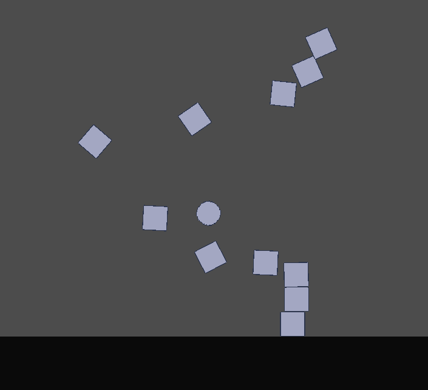
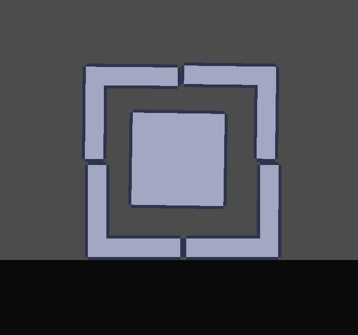
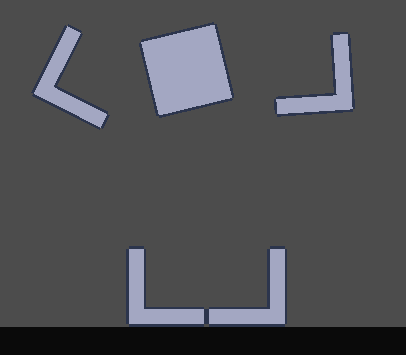
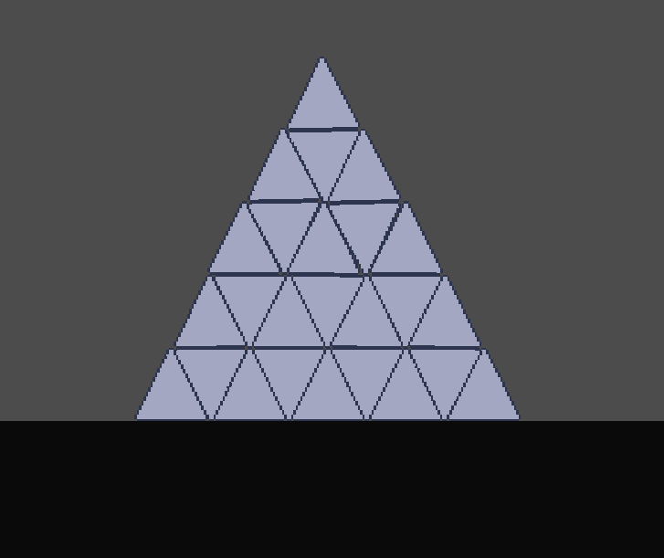
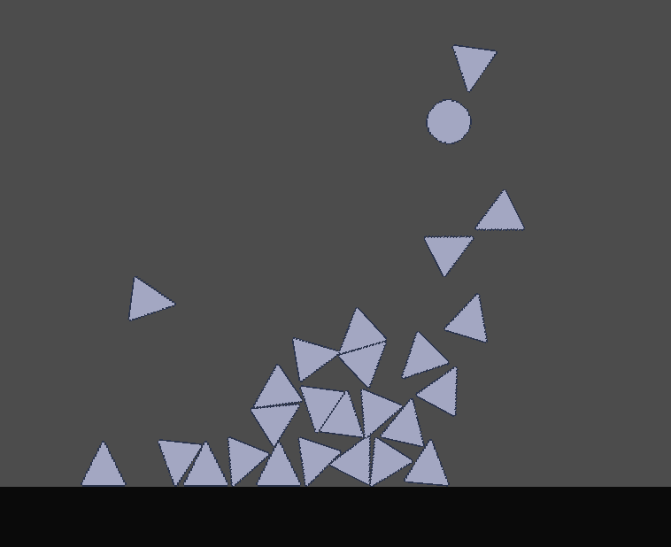

  <h1>Physics Playground</h1>
  
A small game by WirelessNine

&nbsp;&nbsp;&nbsp;Physics playground is a very simple and primitive physics sandbox and simulation game made to experiment with physics.

  

## Features
 - **Interactive sandbox**: Drag and thrown objects across the screen and watch structures collapse.
 - **Time manipulation**: Slow or pause time to see how structures fall apart.
 - **Body rotation**: Change the rotation of bodies to make good looking structures.

## Running
 - Download the zip from the repository or itch: https://wirelessnine.itch.io/physics-playground.
 - Unzip the folder.
 - Make sure to keep the DLL, otherwise the physics won't work.
 - Run the executable

## Controls
 - **Left Click** to drag/move objects.
 - **Middle Click** to pan the camera.
 - **Scroll Wheel** to zoom in and out.
 - **E** to spawn bodies.
 - **G** to slow down time.
 - **Space** to pause time.

## Other Stuff

&nbsp;&nbsp;&nbsp;This game was built using the Godot Engine and Rapier2D physics.

&nbsp;&nbsp;&nbsp;My main source of inspiration for this project was People Playground, a more mature (and gorey) physics sandbox, and I wanted to see if I could make a game similar to it, and it was difficult a lot more difficult than I anticipated, I was not prepared. Physics are very hard to work in, even more when you have to manipulate forces by yourself.

<table align="center">
  <tr>
    <td>"</td>
    <td>"</td>
  </tr>
</table>

&nbsp;&nbsp;&nbsp;Despite the difficulties I learned a few things, and those are using RigidBody2D's _integrate_forces() and the PhysicsServer2D, which I haven't touched since now. I honestly love using low level systems. I would have paired the PhysicsServer2D with the RenderingServer, but it would have been complicated. Despite what I learned, I will not continue working on this project, you are free to look in the code and expand upon it if you want!

&nbsp;&nbsp;&nbsp;P.S: If you encounter a bug where bodies randomly freeze and can't be interacted with anymore, don't ask me to fix it, I genuinely don't know how, I tried.

<table align="center">
  <tr>
    <td></td>
    <td></td>
  </tr>
</table>
